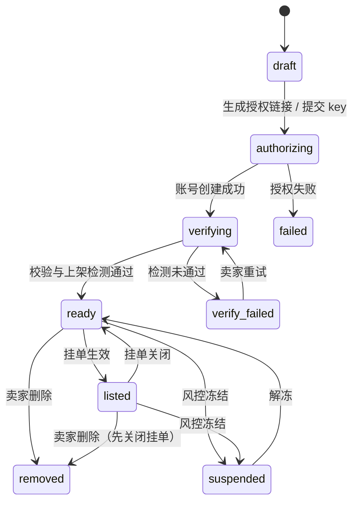

# 04 上游与挂单

## 1. 第一期支持的上游

| 厂商 | sub2api 平台 | 接入方式（sub2api Admin API） | 窗口 | 自留比例 | 额外控量手段 |
|---|---|---|---|---|---|
| Claude（Pro / Max） | `anthropic` | OAuth：`/admin/accounts/generate-auth-url` → `/exchange-code`；Setup Token：`/generate-setup-token-url` → `/exchange-setup-token-code` | 5h / 周 | 支持 | `window_cost_limit`、`base_rpm`、`max_sessions` |
| ChatGPT / Codex | `openai` | `/admin/openai/generate-auth-url` → `/exchange-code` → `/create-from-oauth`；Codex PAT：`/create-from-codex-pat` | 5h / 周 | 支持 | — |
| Gemini（Google One：个人订阅 Google AI Pro / Ultra） | `gemini` | `/admin/gemini/oauth/auth-url`（`oauth_type=google_one`）→ `/exchange-code` | 按 Google 配额 | **不支持** | 并发 |
| Gemini（GCP Code Assist：Standard / Enterprise） | `gemini` | 同上，`oauth_type=code_assist`，可带 `project_id`（留空由 sub2api 自动探测，付费版通常要填） | 按 Google 配额 | **不支持** | 并发 |
| Antigravity | `antigravity` | `/admin/antigravity/oauth/auth-url` → `/exchange-code` | 按配额 | **不支持** | 并发 |
| Grok | `grok` | `/admin/grok/oauth/auth-url` → `/exchange-code` → `/create-from-oauth` | 配额窗口 | 支持 | — |
| Kimi Coding Plan | `kimi` | `POST /admin/accounts`，`apikey` 类型，`credentials.account_mode=coding` | 5h / 周 | 支持 | 日 / 周额度 |
| 智谱 GLM Coding Plan（国内站 bigmodel.cn，含团队版） | `zhipu` | 同上；团队版另写 `credentials.zhipu_organization` / `zhipu_project` | 5h / 周 | 支持 | 日 / 周额度 |
| 智谱 GLM Coding Plan（国际站 z.ai） | `zhipu` | 同上，`base_url=https://api.z.ai/api/coding/paas/v4` | 5h / 周 | 支持 | 日 / 周额度 |
| MiniMax Coding Plan（国内站 minimaxi.com） | `minimax` | 同上 | 5h / 周 | 支持 | 日 / 周额度 |
| MiniMax Coding Plan（国际站 minimax.io） | `minimax` | 同上，`base_url=https://api.minimax.io/v1` | 5h / 周 | 支持 | 日 / 周额度 |
| OpenCode Go | `opencode_go` | 同上，`account_mode=go` | 5h / 周 / 月 | 支持 | 日 / 周额度 |

说明：

- **自留比例**通过账号级 `credentials.account_scheduling_threshold` 实现：窗口用量达到阈值就暂停调度，阈值 = 100 − 自留比例。窗口用量来自官方，**卖家自己使用的部分也计算在内**，所以平台只会卖掉卖家用不完的部分。sub2api 只对 openai、anthropic、grok、kimi、zhipu、minimax、opencode_go 支持这个阈值，Gemini 和 Antigravity 只能整号出售。
- OAuth 各接口的具体参数（代理、会话 ID 等）实现时以 sub2api 前端的调用顺序为准。
- 本系统的接入方式（`upstreams.auth_type`）：Claude `oauth` / `setup-token`；Gemini `google_one` / `oauth`（Code Assist）；智谱、MiniMax `coding`（国内站）/ `coding-intl`（国际站）；OpenCode `go`；其余 `oauth` 或 `coding`。管理员在"厂商"中选择每家开放哪些接入方式。
- 以上覆盖了 sub2api 0.2.14 支持的全部订阅类接入。不收的：DeepSeek（只有按量付费）、TypeSafe（API Key）、OpenCode Zen（按量付费）、Gemini AI Studio（API 用量，且需要自备 OAuth 客户端）、Antigravity upstream（中转）、各家官方 API Key / Bedrock / Vertex（按量付费）；Ollama Cloud 订阅需要卖家交出 ollama.com 的浏览器会话才能查询用量，第一期也不收。
- sub2api 开启出站地址白名单（`security.url_allowlist.enabled`）时，需要把 `api.z.ai`、`api.minimax.io` 加入 `upstream_hosts`，否则国际站账号无法使用。

## 2. 上架流程

卖家先在“代理 IP”中登记固定出口代理（HTTP / HTTPS / SOCKS5 / SOCKS5H，支持用户名和密码），同步就绪且连通性检测成功后才能在接入账号时选择。导入 sub2api 账号时也可以不选代理，改用导出文件中该账号的代理：导入时登记到卖家代理列表并实测连通，通过后才绑定并导入，未通过时不导入（代理连同失败报告留在列表中）。列表仅包含自己的代理，每个代理同时只能绑定一个账号，授权、令牌交换和模型调用使用同一绑定代理；密码加密保存且不回显。账号移除完成后释放代理，移除中和授权失败的账号仍占用代理。

平台设置 `require_seller_proxy` 默认开启，要求新账号选择卖家提供的代理；关闭后，卖家可选择自己的代理，也可不传 `proxy_id`，由平台从平台库存自动关联专用代理。平台基线账号始终使用平台库存，卖家代理不会进入平台分配池。已有账号绑定不随设置切换而变化。`allow_no_proxy` 仅在平台分配模式下允许开发环境无代理接入，不能绕过卖家必填要求。

### 2.1 OAuth 类

```
卖家配置代理列表，再选择厂商、接入方式和一个空闲代理
  → 本系统创建上游草稿并独占绑定所选代理（代理配置已同步到 sub2api）
  → 调 sub2api 生成授权链接（带代理）→ 卖家在官方页面登录授权，回填授权码
  → 调 sub2api 换取 token → 创建 sub2api 账号：
      名称 tm-u-<id>，分组只有 tm-probe-<id>，notes 写 tm:upstream:<id>
  → 补充信息：订阅档位从令牌信息读取（plan_type / tier_id / subscription_tier）；
      OpenAI、Antigravity 的 OAuth 账号调 set-privacy 关闭训练数据使用（sub2api 只支持这两类）
  → 上架检测（必做，不受厂商检测开关影响；见决策 D18）
  → 卖家选择挂单模式 → 确认价格 → 挂单生效
```

### 2.2 Coding Plan 类

```
卖家粘贴 Coding Plan key
  → 创建 sub2api 账号：apikey 类型，account_mode=coding（或 go）；国内站不填 base_url，
      国际站填本系统内置的官方地址（z.ai / minimax.io）；智谱团队版带上组织 / 项目 ID
  → 调 /admin/cn-providers/accounts/:id/quota 查询官方窗口用量
      查不到窗口数据 → 判定不是订阅 key，删除账号，拒绝上架
  → 后续同 OAuth 类
```

**base_url 不允许卖家填写**：国内站使用 sub2api 按 `account_mode` 选择的官方默认地址，国际站使用本系统内置的固定官方地址，卖家只能选择站点。否则卖家可以拿中转站的 key 冒充 Coding Plan。

### 2.3 上架校验清单

| 校验 | 不通过时 |
|---|---|
| 授权成功，sub2api 账号创建成功 | 上架失败，可重试 |
| 订阅档位可识别 | 记为未知档位，按最低档报价 |
| 隐私设置已关闭训练数据使用（支持的厂商） | 不允许上架 |
| Coding Plan 能查到官方窗口数据 | 拒绝上架 |
| 挂单涉及的模型在 sub2api 中有官方价 | 不允许上架，否则结算没有依据 |
| 同一官方账号未被其他上游占用 | 拒绝上架（按账号标识去重） |
| 卖家未被风控冻结 | 拒绝上架 |
| 上架检测通过（首次配置必做） | 进入"检测未通过"，卖家可查看报告后重试；检测无法开始（例如策略没有配置模型）同样记为未通过并说明原因 |

## 3. 挂单模式

第一期三种形态，同一上游同时只能有一条有效挂单：

| | 按量寄售 | 额度包 | 平台回收 |
|---|---|---|---|
| 买家怎么买 | 付最低额度 M（可为 0）后按量扣平台余额 | 整包付面额，调用从包内扣；未用量可退货 | 不进市场，只进保障池 |
| 倍率 | 卖家自定 m_s | 卖家自定包内倍率 | 平台报价 m_b |
| 市场展示 | 展示 | 展示（`sku_kind=pack`） | 不展示 |
| 默认分组 | 默认可加入 | **不加入** | 加入，最优先 |
| 库存 | 无份数 | 可售份数，售出占用，退货释放 | 无 |

## 3.1 两种按量挂单（寄售与回收）

| | 寄售 | 平台回收 |
|---|---|---|
| 倍率 | 卖家自定 m_s，必须在平台设定的区间内 | 平台按等级报价 m_b，卖家接受后生效 |
| sub2api 账号 `rate_multiplier` | m_s | m_b |
| 买家价 | 被指定时 p = m_s × (1 + c)；在默认分组中按 D | 只在默认分组中按 D |
| 市场展示 | 展示，可被买家指定 | 不展示 |
| 默认分组 | 默认加入，卖家可以退出；需满足 m_s ≤ D × (1 − 最低毛利 − 安全缓冲) | 加入，最优先 |
| 卖家收益 | Σ total_cost × m_s | Σ total_cost × m_b |

**改价规则**

- 寄售改价有冷却时间（如 1 小时一次），新价格只影响之后的请求。sub2api 会在每条 usage_log 里记下当时的账号倍率，历史结算不受影响。
- 回收报价有有效期。平台定期按最新等级重新报价，卖家不接受时挂单进入"待确认"并暂停调度。
- 切换模式需要先关闭当前挂单，再创建新挂单。

## 4. 状态机

### 4.1 上游状态



### 4.2 健康状态（系统根据检测与被动信号维护）

| 健康状态 | 含义 | 是否调度 |
|---|---|---|
| `healthy` | 正常 | 是 |
| `limited` | 窗口用到阈值，等待重置（正常现象） | sub2api 自动暂停，重置后自动恢复 |
| `suspected` | 疑似降智，正在加密探测 | 是 |
| `degraded` | 确认降智（账号本身原因） | **否** |
| `unavailable` | 授权失效、被封禁、订阅到期等 | **否** |
| `unknown` | 尚未通过上架检测 | **否**（首次配置必须先检测，决策 D18）。上架检测通过后变为 `healthy`；结论不够明确时为 `suspected` |

### 4.3 挂单状态

`pending_quote`（回收待报价）→ `pending_confirm`（待卖家确认）→ `active` ⇄ `paused`（卖家暂停 / 系统暂停）→ `closed`

挂单 `active` 且上游健康状态允许调度时，调度器才会把它放进买家可用的分组。

## 5. "不调度"怎么实现

不调度 = 把账号从所有买家可用的分组（默认分组、寄售专属分组）中移出，**只保留在探测分组**。

不用 sub2api 的 `schedulable=false`，因为那会让账号在所有分组里都不可调度，探测分组也打不通，暂停后就没法复测恢复。`schedulable=false` 只用于彻底停止的场景：卖家删除上游、授权被撤销、风控冻结。

移出分组会打断该账号上的粘性会话。被判为降智或不可用的账号本来就不该继续服务，可以接受。

## 6. 重新授权

令牌被撤销、修改密码等导致授权失效时，sub2api 把账号标为 error，调度器同步为 `unavailable`（不调度）。卖家调用 `POST /api/seller/upstreams/:id/reauthorize` 拿到新的授权链接，授权后用 `oauth/complete` 提交：

- 必须是**同一个官方账号**（按账号标识比对），否则拒绝（`IDENTITY_MISMATCH`），防止拿别的账号顶替而继承原账号的等级与历史；
- 只更新 sub2api 账号的凭证（带上窗口阈值，因为 sub2api 更新凭证是整体替换），再调 `clear-error` 清除错误状态；支持的厂商重新设置隐私；
- 上游状态、挂单、等级、质量记录不变；调度器下一轮看到账号恢复后把健康状态从 `unavailable` 改回原状态，重新接流量。

## 7. 下架与删除

- **卖家暂停**：立即不调度，挂单保留。
- **卖家关闭挂单**：不调度；寄售专属分组在没有 key 绑定后回收；绑定了这个挂单的买家链会跳过它，并在买家控制台提示。
- **卖家删除上游**：先关闭挂单，再把 sub2api 账号设为不可调度，等进行中的请求结束（5 分钟）后删除账号，然后删除探测分组、释放代理。未结算的收益照常结算。
